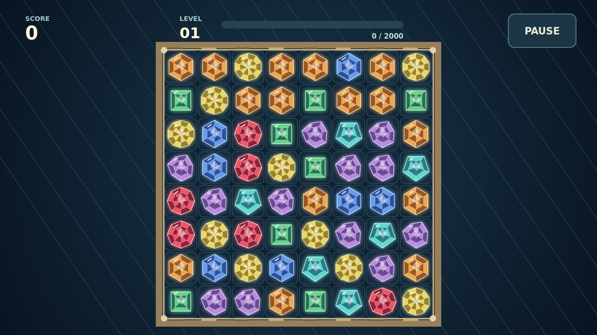

# Facet

A clear is only the beginning. Trade neighboring stones to bring three of a kind into line, then watch the board close over the space they leave.

Every shattered gem presses on the stones beside it. Small cracks spread into deep fractures, and a fully flawed stone bursts with any clear that touches it. A move beside a strained cluster can turn a modest match into a chain worth far more.

Shape the board with special cuts. A line of four leaves a brilliant that takes its surrounding ring; five or more leaves a prism that clears an entire kind when swapped. Cross two lines to earn a star that sweeps its row and column.

The level meter climbs with each move, carrying your total score forward. Keep finding swaps as the stones fall: a round lasts until the board has no move left.

